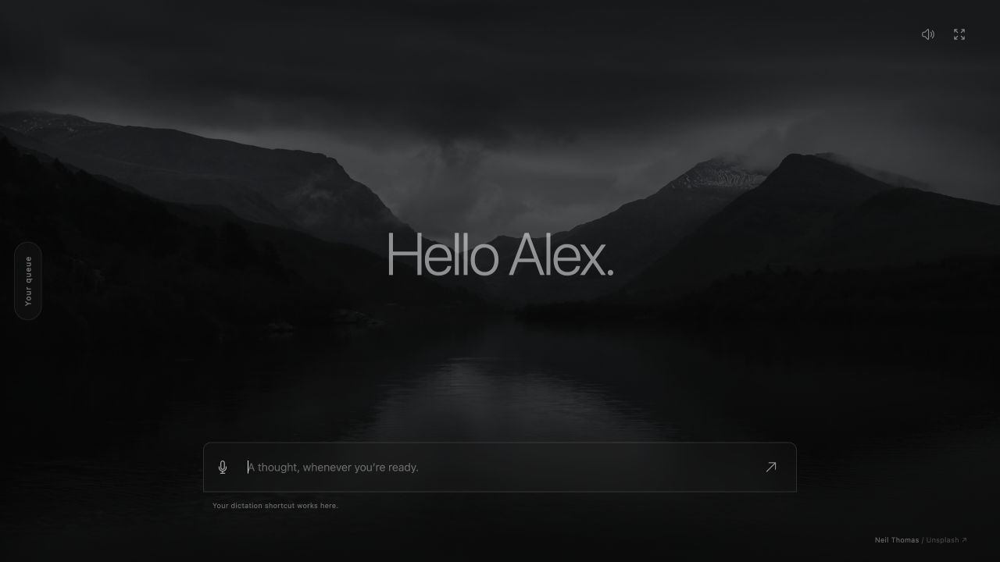

# Lounge

A quiet local room for working through parallel agents. Speak a complete thought, route work to an agent, and return when a result or decision needs you.

Lounge keeps one conversation on screen. The queue lives behind the left edge. **Space** plays a personalized greeting and opens the input. Tell Lounge to start the queue, add a task, or find an existing conversation.



## Run locally

Use Node 22.13 or newer and a signed-in Codex CLI that supports `app-server`.

```sh
npm ci
npm start
```

Open [localhost:4317](http://127.0.0.1:4317). No hosting is required. The server binds to loopback and validates Host, Origin and a session mutation capability. Do not expose it through a tunnel or public network.

For the bundled Mac app:

```sh
npm run build:mac
open dist/Lounge.app
```

The Mac build requires Xcode command-line tools and a standalone Node distribution. It packages the room, Node runtime, dependencies and Claude bridge into one app. It is locally ad-hoc signed, not a notarized release. Updating such a build may require refreshing its existing macOS Accessibility entry.

Development data lives in ignored `data/`. The installed app uses `~/Library/Application Support/Command Lounge/`. Queue state, credentials, source context and drafts are never bundled or committed. Native provider sign-ins stay with their CLIs.

## The interaction

- Dictate with your existing Wispr shortcut. A completed paste into the focused room submits automatically; typing waits for Enter. Escape holds a pending submission. Microphone capture submits after an explicit stop, never after silence.
- Start the queue to hear a prepared brief. Returning to a task emphasizes what changed and what needs deciding. Actual alternatives remain visible and are read aloud.
- The queue is project-first: **P1, P2…**, then chats inside each project. Drag a project handle to move the whole group, or a chat handle to reorder inside that project. Alt+Up/Down also works. Disclosure bars collapse without pausing work. **Focus top task** selects the first eligible chat in project order. New results preserve the current draft and question.
- Use a task’s **···** menu to mark it Work/Personal or Remove from queue. Removal has Undo and preserves the original conversation. Moving on never clears a task.
- Ask to snooze a task or change which project categories enter rotation. Settings → Flow also selects All, Work only or Personal only. Cmd+Shift+P toggles Work only/All.
- Ask to find an existing conversation. Review its preview before import. Bringing it fully into Lounge creates a linked continuation in a supported agent runtime; it does not bulk-migrate or overwrite the original.
- Read aloud uses your system voice or an optional ElevenLabs API connection. Select a voice, pace and delivery in Settings. Shared library voices can require a paid provider plan.

## Runtimes and source ownership

| Application | Integration |
| --- | --- |
| Codex | Local app-server with the existing sign-in; managed workers and coordination; imported desktop chats remain source-owned. |
| Claude Code | Official Agent SDK with native Claude subscription sign-in. Install the CLI, run `claude auth login`, then connect in Settings. |
| Claude chat / Cowork | Existing conversations through the bundled Mac Accessibility bridge, explicitly enabled in Settings. New work uses the SDK or app-server. |
| ChatGPT | Source-link handoff; no consumer-chat execution API. |
| Local models | Optional existing OpenAI-compatible server for coordination with tools and JSON output. Lounge does not start or download a model service. |
| Hermes | Application identity reserved; worker adapter not connected. |

Coordinator and worker model selectors are independent. Available models/effort come from their runtime. API-key or alternate-cloud billing is not silently substituted for native subscription sessions. No direct OpenAI/Anthropic API billing adapter is included.

Only one writer may own a workspace. Imported sessions are never resumed through a competing process. Native handoff releases the managed writer; returning carries the latest source context into a fresh linked continuation. Files, connectors and hidden provider context are not automatically transferred.

The Claude bridge is restricted to Claude. An unlocked Mac and Accessibility permission are required. Unsupported/ambiguous approvals remain in their source application. Artifacts are escaped text and source links, not arbitrary executable canvases. The bridge is more fragile than a native agent protocol; see its [limits and qualification](docs/DESKTOP-CONTROL.md).

## Development

```sh
npm run check
npm test
npm run check:public
```

[Architecture](docs/ARCHITECTURE.md) · [Design review](docs/DESIGN.md) · [Prompt routing](docs/PROMPTING.md) · [Progress](docs/PROGRESS.md)

Project priorities and chat order persist independently and are included in exports. Voice requests can use the same project/chat ordering tools. Personal filters and snooze retain hidden positions. Settings use one open section at a time, keep Save visible, and preserve unsaved edits when closed.

The public branch starts from a clean source baseline. Private pre-publication history stays local and must not be merged or pushed. Commit focused changes after verification. Photo and icon credits are in [assets/CREDITS.md](public/assets/CREDITS.md).
